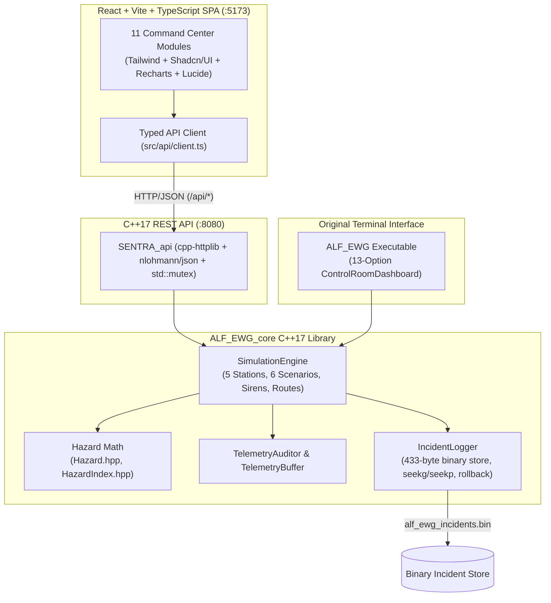

# SENTRA — Smart Environmental Navigation & Threat Response Architecture

**Anticipate. Alert. Protect.**

> **Live Demo:** [Open SENTRA Command Center](https://super-duper-succotash-q7grpxwxj67rh4j9-5173.app.github.dev/)

> **Demo Access:** The shared demo password is displayed directly on the login screen. Use the **Copy** button there to access the interactive demo.

> **Availability:** This demo is hosted through GitHub Codespaces. The link is available while the Codespace and its frontend/backend processes are running; it may return an unavailable/502 page after the Codespace is stopped or suspended. 

SENTRA is a full-stack disaster intelligence and early warning platform built around the **C++17 ALF-EWG** (*Autonomous Landslide & Flash-Flood Early Warning Grid*) simulation and monitoring engine. It pairs deterministic C++17 geotechnical and hydrological hazard modeling, automatic regional sirens, evacuation route prioritization, and binary incident persistence with a modern **React + TypeScript + Tailwind CSS** emergency operations command center.

> **Simulation Disclaimer:** All telemetry readings, risk scores, siren states, evacuation route recommendations, and incident logs produced by SENTRA / ALF-EWG are simulated for demonstration and educational purposes and are not connected to field sensors or emergency services.

---

## Problem Statement & Why SENTRA Exists

Mountainous Himalayan districts face compounding hazards where intense rainfall, rising pore-water soil saturation, seismic ground vibrations, and rapid river-level surges can trigger landslides and flash floods simultaneously. Averaging independent hazard scores can mask a life-threatening spike in one domain, while unvalidated sensor payloads or corrupted logs can undermine emergency response.

**SENTRA** solves this by:
- Preserving a strict **C++17 core engine (`ALF_EWG_core`)** where all physical hazard normalization, risk classification, siren state transitions, route ranking, and binary persistence run natively.
- Exposing the engine over a thread-safe **C++17 REST API (`SENTRA_api`)** without duplicating any business logic in JavaScript.
- Delivering an **11-module command-center web interface** for real-time situational awareness, scenario simulation, incident auditing, and diagnostics alongside the original 13-option terminal control room (`ALF_EWG`).

---

## Key Features

- **11-Module React Command Center**: Overview Dashboard, Live Monitoring, Simulation Center, Regional Hazard Analysis, Emergency Alerts, Siren Control (monitoring-only), Evacuation Planning, Incident History, Telemetry Audit, System Statistics, and System Diagnostics.
- **Deterministic C++17 Simulation Engine (`SimulationEngine`)**: Models 5 Himalayan stations across 6 threat scenarios plus validated manual telemetry injection.
- **Independent Dual-Domain Risk Scoring**: Computes Landslide Risk (`0–100`) and Flood Risk (`0–100`) independently and takes `max(landslide, flood)` so severe single-domain threats are never diluted.
- **Automated Regional Sirens (`EarlyWarningSiren`)**: Automatically activates at `overallRisk >= 50.0` (`HIGH` / `CRITICAL`) and clears below `50.0`, with alert deduplication and escalation tracking.
- **Evacuation Route Prioritization (`EvacuationPriority`)**: Filters out blocked or critical-risk (`>= 75.0`) corridors and ranks safe routes by hazard and road condition over distance.
- **433-Byte Random-Access Binary Store (`IncidentLogger`)**: Persists `HIGH`/`CRITICAL` and critical-battery (`<= 15%`) incidents to disk with `seekg()`/`seekp()` in-place updates and automatic rollback on failure.
- **Preserved Terminal Control Room (`ALF_EWG`)**: Original 13-option interactive CLI dashboard with ANSI/plain-text support (`--no-color`, `--color`, `NO_COLOR`).
- **17 Automated CTest Suites (`ALF_EWG_tests`)**: Full unit and integration verification of C++ OOP concepts, persistence, rollback, and dashboard behavior.

---

## Screenshots

> The live deployment link above opens the interactive command center. Screenshots can be added here as the interface evolves.

| Module | Preview |
|---|---|
| Overview Dashboard (`/`) | _[Placeholder: Overview Dashboard Screenshot]_ |
| Live Monitoring (`/monitoring`) | _[Placeholder: Live Monitoring Screenshot]_ |
| Simulation Center (`/simulation`) | _[Placeholder: Simulation Center Screenshot]_ |
| Regional Hazard Analysis (`/hazards`) | _[Placeholder: Regional Hazard Analysis Screenshot]_ |

---

## System Architecture



---

## Technology Stack

| Layer | Technologies |
|---|---|
| **Frontend** | React 19, Vite 6, TypeScript, Tailwind CSS 3, Shadcn/UI primitives, Lucide React, Recharts, React Router DOM |
| **REST API** | C++17, `cpp-httplib` (v0.18.3, vendored), `nlohmann/json` (v3.11.3, vendored), `std::mutex` |
| **Core Engine** | C++17 (`ALF_EWG_core`), CMake 3.15+, `std::mt19937`, `std::fstream` binary I/O |
| **Testing & Lint** | 17 CTest suites (`ALF_EWG_tests`), `oxlint`, `tsc -b` |

---

## C++ Object-Oriented Programming Concepts Demonstrated

The underlying `ALF_EWG_core` library demonstrates core C++17 OOP principles (mapped in [docs/syllabus-mapping.md](docs/syllabus-mapping.md)):
- **Encapsulation & Validation**: `SensorStation`, `EarlyWarningSiren`, `RegionalHazard`, `Telemetry`, and `SimulationEngine` enforce bounds in constructors and methods.
- **Function Overloading**: `computeHazardIndex(rainfallRate, slopeAngle)` and `computeHazardIndex(soilSat, vibrationFreq, tiltAngle)` in [HazardIndex.hpp](include/sensors/HazardIndex.hpp).
- **Dynamic Memory & Rule of Five**: `TelemetryBuffer` manages a raw `double*` heap array with deep copy constructor, copy-and-swap assignment, `noexcept` move constructor/assignment, and destructor.
- **Static Members**: `SensorStation::activeCount_` and `EarlyWarningSiren::globalAlertLevel_`.
- **Friend Classes & Operator Overloading**: `friend class TelemetryAuditor` in `Telemetry`; `operator>`, `operator<<`, `operator>>`, `operator+`, `operator[]`, and `EvacuationPriority::operator()`.
- **Composition (`HAS-A`) & Virtual Diamond Inheritance**: `BaseSensorNode` owns `PowerSubsystem`; `AutonomousHybridProbe` inherits virtually from `SolarPoweredNode` and `WirelessLoRaTransceiver` over `DisasterTelemetryDevice`.
- **Runtime Polymorphism**: `executeSensorSweep(const std::vector<BaseSensorNode*>&)` dispatches `LandslideStationProbe` and `FloodStationProbe` via base pointers.
- **Custom Exceptions, Templates & STL**: `SensorFailureException`, `TelemetryChecksumMismatch`, `ThresholdOverflowException`, `PriorityQueue<T>`, and STL algorithms.

---

## Five Monitored Himalayan Regions

| Station ID | Region | Latitude (°N) | Longitude (°E) |
|---|---|---|---|
| `UK-UTT-01` | Uttarkashi | `30.7268` | `78.4354` |
| `UK-CHA-02` | Chamoli | `30.4020` | `79.3206` |
| `UK-RUD-03` | Rudraprayag | `30.2844` | `78.9811` |
| `UK-JOS-04` | Joshimath | `30.5550` | `79.5650` |
| `UK-PIT-05` | Pithoragarh | `29.5829` | `80.2182` |

---

## Six Simulation Scenarios

| Scenario Key | Display Name | Behavior in `SimulationEngine` |
|---|---|---|
| `Normal` | Normal conditions | Baseline station readings with 4% Gaussian sensor jitter |
| `HeavyRainfall` | Heavy rainfall | `48–66 mm/h` rainfall, `+0.18` soil saturation, `+0.7 m` river level |
| `IncreasingSoilSaturation` | Increasing soil saturation | Progressive `+0.09/cycle` soil saturation (up to `0.97`), `8.0 mm/h` rain |
| `AbnormalSeismicVibrations` | Abnormal seismic vibrations | `25–43 Hz` vibration spikes with `+5.0°` slope tilt |
| `RapidRiverRise` | Rapid river-level increase | Progressive `+0.75 m/cycle` river rise (up to `5.9 m`), `18.0 mm/h` rain |
| `CombinedThreat` | Combined landslide and flash-flood threat | `80–95 mm/h` rain, elevated soil saturation, `25–40 Hz` vibration, `+12°` tilt, `+3.8 m` river |

---

## Hazard Detection, Alerts, Evacuation & Persistence

- **Risk Calculation (`0–100`)**:
  - `LandslideRisk`: weighted combination of `soilSaturation` (40%), `rainfallSeverity` (25%), `vibrationSeverity` normalized to 40 Hz (20%), and `tiltAngle` normalized to 30° (15%).
  - `FloodRisk`: `floodSeverity(riverLevel)` (75%) + `rainfallSeverity` (25%).
  - `OverallRisk = max(LandslideRisk, FloodRisk)`.
- **Classifications & Automatic Sirens**:
  - `[0, 25)` **LOW** · `[25, 50)` **MODERATE** · `[50, 75)` **HIGH** · `[75, 100]` **CRITICAL**.
  - Sirens activate automatically at `overallRisk >= 50.0` and clear below `50.0` (the web UI is monitoring-only).
- **Evacuation Route Evaluation**:
  - Excludes `Blocked` or unavailable routes and routes with adjusted risk `>= 75.0`.
  - Applies `0.45 * stationRisk` plus road condition surcharges (`Slippery`, `Damaged`) and ranks via `EvacuationPriority`.
- **Incident Persistence & Telemetry Audit**:
  - `HIGH`/`CRITICAL` (`>= 50.0`) and low-battery (`<= 15.0%`) events are saved as 433-byte binary records in `alf_ewg_incidents.bin`.
  - Supports in-place updates via `seekp()` with automatic rollback on failure, `TelemetryAuditor` inspection, `TelemetryBuffer` deep copies, and FNV-32 payload checksums.

---

## Frontend Modules (11 Pages)

| Section | Module | Route | Purpose |
|---|---|---|---|
| **Command Center** | Overview Dashboard | `/` | Grid KPIs, Landslide vs. Flood chart, regional risk matrix, alerts, incidents, routes |
| **Command Center** | Live Monitoring | `/monitoring` | 5-station telemetry cards, 5s polling, risk filters, station detail drawer |
| **Operations** | Simulation Center | `/simulation` | 6-scenario runner (`1–10` cycles) & validated manual telemetry form with confirmation |
| **Operations** | Regional Hazard Analysis | `/hazards` | Ranked `RegionalHazard` table, overloaded indices, contributing telemetry drawer |
| **Operations** | Emergency Alerts | `/alerts` | Active warnings, offline/low-battery flags, session transition log, detail drawer |
| **Operations** | Siren Control | `/sirens` | Monitoring-only regional siren states, coordinates, `globalAlertLevel`, threshold info |
| **Operations** | Evacuation Planning | `/evacuation` | Prioritized safe corridors, `GOOD`/`SLIPPERY`/`BLOCKED` badges, route detail drawer |
| **System** | Incident History | `/incidents` | Persisted binary log, exact-ID lookup, filters, confirmation-gated `PATCH` route update |
| **System** | Telemetry Audit | `/audit` | `TelemetryAuditor` history, `TelemetryBuffer` snapshot chart, FNV-32 checksums |
| **System** | System Statistics | `/statistics` | Current snapshot aggregates, `RiskDistribution` & averages charts |
| **System** | System Diagnostics | `/diagnostics` | Live 6-point C++17 self-diagnostic runner (`POST /api/diagnostics`) |

---

## API Documentation

All 15 REST endpoints are documented in [docs/api.md](docs/api.md), including request/response schemas, validation bounds, and error codes.

---

## Project Directory Structure

```text
Disaster_Management/
├── CMakeLists.txt                  # Builds ALF_EWG_core, ALF_EWG, ALF_EWG_tests, SENTRA_api
├── LICENSE                         # MIT License
├── README.md
├── .gitignore
├── include/
│   ├── alerts/                     # AlertTypes.hpp
│   ├── core/                       # Simulation, IncidentLogger, Siren, Telemetry, SensorNode, etc.
│   ├── sensors/                    # Hazard.hpp, HazardIndex.hpp
│   ├── ui/                         # Dashboard.hpp
│   └── third_party/                # Vendored httplib.h and nlohmann/json.hpp
├── src/
│   ├── main.cpp                    # Original terminal control-room entry point
│   ├── api/ServerMain.cpp          # SENTRA C++17 REST API server (:8080)
│   ├── core/                       # Core C++17 implementations
│   └── ui/Dashboard.cpp            # 13-option terminal dashboard
├── tests/main_test.cpp             # 17 CTest suites
├── docs/                           # Architecture, algorithms, API reference, user guide, viva prep
└── frontend/                       # React + Vite + TypeScript + Tailwind SPA (:5173)
    ├── index.html
    ├── package.json
    ├── vite.config.ts              # Dev proxy /api -> http://127.0.0.1:8080
    └── src/
        ├── api/client.ts           # Typed fetch client
        ├── types/sentra.ts         # TypeScript contracts
        ├── hooks/useBackendHealth.ts
        ├── components/             # ui/, common/, layout/
        └── pages/                  # 11 SENTRA operational modules
```

---

## Prerequisites & Setup

- **C++17 Compiler**: MinGW-w64 `g++` (tested with MSYS2 UCRT64 GCC 16.2.0), Clang, or MSVC
- **CMake**: `3.15+` (with `mingw32-make`, Ninja, or Make)
- **Node.js & npm**: Node.js `18+` (tested with Node `v24.21.0` and npm `11.19.0`)

### 1. Build C++ Targets (Core, Terminal App, Tests & REST API)

```powershell
cmake -S . -B build -G "MinGW Makefiles"
cmake --build build
```

### 2. Install Frontend Dependencies

```powershell
cd frontend
npm install
```

---

## Running Locally

### Start the C++ REST API (`:8080`)
```powershell
.\build\SENTRA_api.exe --port 8080
```

### Start the React Development Server (`:5173`)
```powershell
cd frontend
npm run dev
```
Open `http://localhost:5173` in your browser. Vite proxies `/api/*` requests to `http://127.0.0.1:8080`.

### Run the Original Terminal Control Room
```powershell
.\build\ALF_EWG.exe
```

---

## Testing

### C++ Automated Tests (17 CTest Suites)
```powershell
ctest --test-dir build --output-on-failure
```

### Frontend Type Check, Lint & Production Build
```powershell
cd frontend
npm run lint
npm run build
```

---

## Configuration & Environment Variables

| Variable / Flag | Default | Purpose |
|---|---|---|
| `SENTRA_HOST` / `--host` | `127.0.0.1` | Bind address for `SENTRA_api` |
| `SENTRA_PORT` / `--port` | `8080` | Listen port for `SENTRA_api` |
| `SENTRA_CORS_ORIGIN` / `--cors-origin` | `http://localhost:5173` | `Access-Control-Allow-Origin` header |
| `--seed` | `211` | Deterministic `std::mt19937` seed |
| `--log-file` | `alf_ewg_incidents.bin` | Binary incident persistence file |
| `VITE_API_BASE_URL` | `""` (uses Vite `/api` proxy) | Production API base URL for `frontend/` |
| `NO_COLOR` / `--no-color` | Auto-detected | Disables ANSI colors in `ALF_EWG` terminal UI |

---

## Public Demo Access

1. Open the [SENTRA live demo](https://super-duper-succotash-q7grpxwxj67rh4j9-5173.app.github.dev/).
2. The shared demo password is displayed on the login screen; use its **Copy** button.
3. Enter the password to open the command center and explore the interactive modules.

The demo allows visitors to run simulations and use the available interactive workflows. Since the password is intentionally public for this demonstration, this gate is for convenience rather than strong access control. Do not use real personal, sensitive, or operational emergency data.

The Codespaces URL is temporary infrastructure, not an uptime guarantee. The Codespace must remain running with both services active for the link to work.

---

## Deployment Preparation

### GitHub Codespaces (Manual Deployment)

A preconfigured devcontainer is provided in [`.devcontainer/devcontainer.json`](.devcontainer/devcontainer.json) with C++17 (`g++`, `cmake`), Node.js 20, and port attributes.

**Live demo:** [https://super-duper-succotash-q7grpxwxj67rh4j9-5173.app.github.dev/](https://super-duper-succotash-q7grpxwxj67rh4j9-5173.app.github.dev/)

The live demo uses a shared password displayed on the login screen. This is a lightweight demo gate, not production-grade authentication. Do not enter sensitive or real emergency-response data.

| Port | Service | Visibility | Notes |
|---|---|---|---|
| `5173` | React + Vite Web Command Center | **Public** | Public entry point; Vite proxies `/api/*` internally to `127.0.0.1:8080` |
| `8080` | `SENTRA_api` C++ REST API | **Private** | Do not expose publicly; accessed through the Vite `/api` proxy |
| `7681` | `ALF_EWG` Terminal Control Room | **Private** | Original terminal dashboard port preserved |

**Important availability note:** The URL is a GitHub Codespaces forwarded address, not permanent production hosting. The demo is reachable only while the Codespace is running and both the backend and frontend processes are active. If the Codespace is stopped or suspended, the site may show an unavailable or `502` page. Restart both services to bring it back online.

Inside a Codespace terminal:

```bash
# 1. Build C++ targets & verify tests
cmake -S . -B build
cmake --build build
ctest --test-dir build --output-on-failure

# 2. Start the private C++ REST API (Terminal 1)
export SENTRA_DEMO_PASSWORD='use-the-public-demo-password-configured-for-this-demo'
./build/SENTRA_api --host 127.0.0.1 --port 8080

# 3. Start the public Vite frontend (Terminal 2)
cd frontend
npm ci
npm run dev -- --host 0.0.0.0
```

Keep the backend and frontend terminals running while the demo is in use. Configure Codespaces port visibility as `5173: Public`, `8080: Private`, and `7681: Private`.

### Independent Cloud Hosting

1. **Frontend Static Hosting** (e.g., Vercel, Netlify, or Cloudflare Pages):
   - Root directory: `frontend`
   - Build command: `npm run build`
   - Output directory: `dist`
   - Environment variable: `VITE_API_BASE_URL=https://<your-sentra-api-domain>`
2. **C++ Backend Hosting** (e.g., Linux container / VPS / Render / Railway):
   - Build `SENTRA_api` with CMake (`cmake -S . -B build && cmake --build build --target SENTRA_api`).
   - Run `./build/SENTRA_api --host 0.0.0.0 --port 8080` with `SENTRA_CORS_ORIGIN=https://<your-frontend-domain>` and persistent volume storage for `alf_ewg_incidents.bin`.

---

## Future Improvements

- Real-time WebSocket or Server-Sent Events (SSE) push stream from `SENTRA_api` to replace 5s/10s polling.
- Interactive geographic map view for the 5 Himalayan stations and evacuation corridors.
- Optional code-splitting (`React.lazy()`) to reduce initial JS bundle size.
- CI/CD GitHub Actions workflow for automated CTest + Vite production build checks.

---

## License & Contributors

- **License**: MIT — see [LICENSE](LICENSE).
- **Attribution**: Core simulation engine (`ALF-EWG`) by `ALF-EWG Contributors` (`Copyright (c) 2026 ALF-EWG Contributors`).
