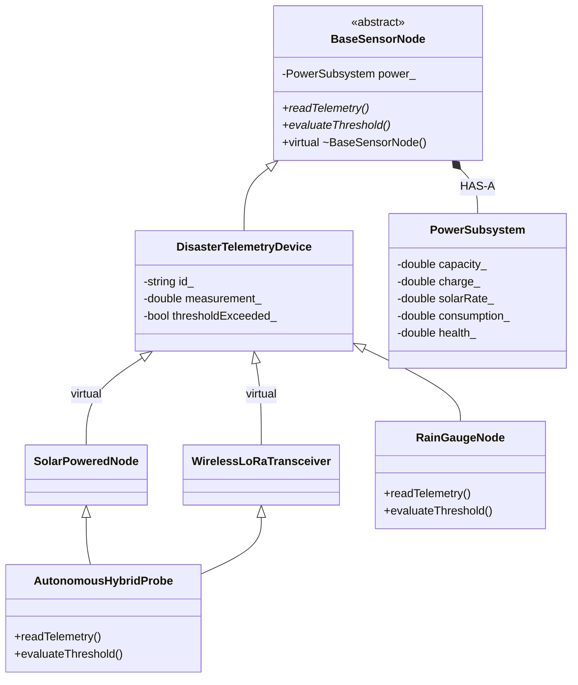

# Sensor node class diagram (CIC-211 Unit III)

`SolarPoweredNode` and `WirelessLoRaTransceiver` virtually inherit the common
`DisasterTelemetryDevice`. Therefore the hybrid probe has one shared device
subobject. `BaseSensorNode` is the polymorphic interface and owns a
`PowerSubsystem` by value. A sweep stores non-owning `BaseSensorNode*` observers;
the example and tests keep ownership in `std::unique_ptr` collections.
