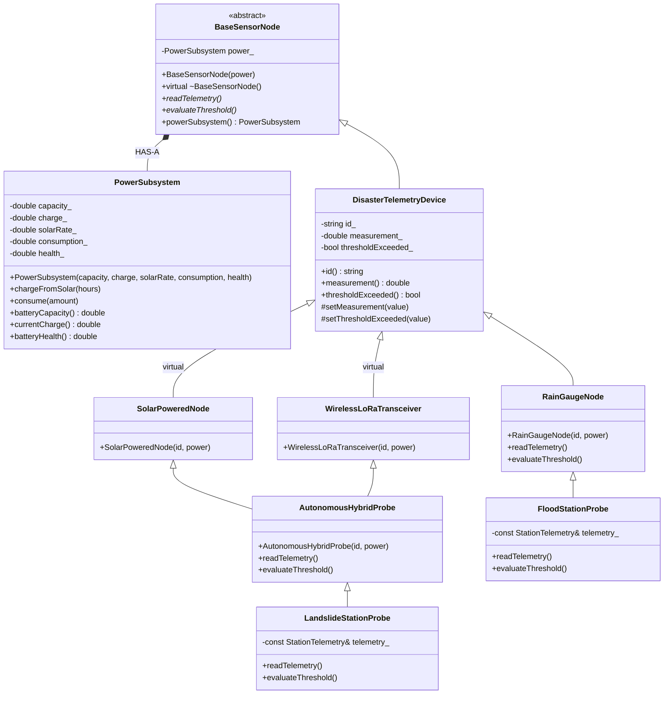
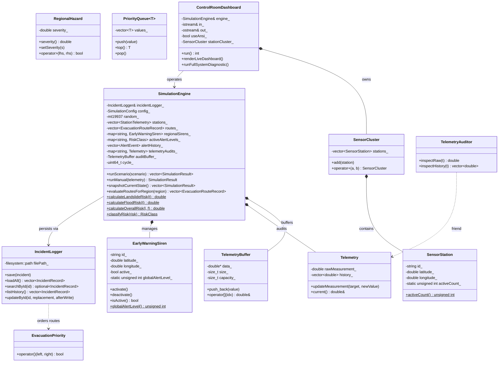

# ALF-EWG UML Class Diagrams

## 1. Sensor Node Inheritance, Virtual Diamond & Composition (CIC-211 Unit III)

`SolarPoweredNode` and `WirelessLoRaTransceiver` virtually inherit `DisasterTelemetryDevice`, ensuring `AutonomousHybridProbe` (and `LandslideStationProbe`) contains exactly **one** shared `DisasterTelemetryDevice` and `BaseSensorNode` subobject.

---

## 2. Core Simulation, Persistence, Telemetry & Dashboard Architecture

